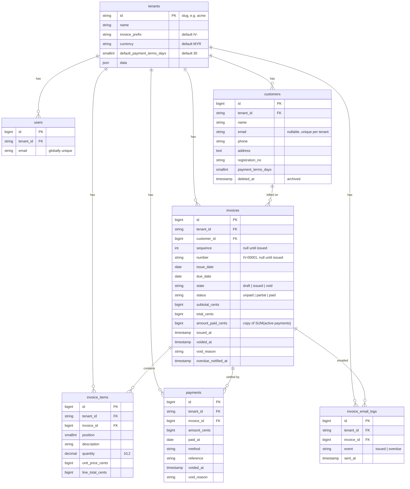

# Database schema (ERD)

PostgreSQL 18, single database, row-level tenancy: every business table carries `tenant_id` (FK to `tenants.id`, `ON DELETE CASCADE`). All money columns are integer cents (`bigint`).

`overdue` is **not** a column value: it is computed as `state = 'issued' AND due_date < today AND status <> 'paid'`.

## Foreign keys

| FK | On delete | Why |
|---|---|---|
| every `tenant_id` -> `tenants.id` | cascade | removing a company removes all of its data |
| `invoices.customer_id` | restrict | a customer with invoices is archived (soft delete), never hard deleted |
| `invoice_items.invoice_id` | cascade | items have no meaning without their invoice |
| `payments.invoice_id` | restrict | payments are voided, never deleted with an invoice |
| `invoice_email_logs.invoice_id` | cascade | log rows belong to the invoice |

## Indexes

| Index | Reason |
|---|---|
| `users(tenant_id)` | per-tenant user lookups and cascade deletes (PostgreSQL does not index FKs automatically) |
| `customers(tenant_id, name)` | customer list sorted / searched by name within a tenant |
| `customers UNIQUE(tenant_id, email)` | email is unique per company, not globally (NULLs allowed repeatedly) |
| `invoices UNIQUE(tenant_id, sequence)` | gap-free per-company numbering; blocks duplicate sequence under concurrency |
| `invoices UNIQUE(tenant_id, number)` | an invoice number is never reused within a company |
| `invoices(tenant_id, state, status, due_date)` | dashboard, outstanding / overdue lists and the daily overdue job |
| `invoices(tenant_id, issue_date)` | sales report by date range and monthly revenue |
| `invoices(tenant_id, customer_id)` | customer invoice list and customer summary report; also covers the FK |
| `invoice_items(invoice_id)` | load / aggregate the items of an invoice |
| `invoice_items(tenant_id)` | tenant scope on the items table and cascade deletes |
| `payments(tenant_id, invoice_id)` | payment sums per invoice (`recalculatePaymentState`) and the invoice payment list |
| `payments(tenant_id, paid_at)` | revenue per period |
| `invoice_email_logs UNIQUE(tenant_id, invoice_id, event)` | idempotency: one email per invoice per event, even if a job retries |
| `invoice_email_logs(invoice_id)` | FK lookup / cascade |

## CHECK constraints (last line of defence)

| Constraint | Rule |
|---|---|
| `customers_payment_terms_days_check` | `payment_terms_days BETWEEN 0 AND 365` |
| `invoices_state_check` | `state IN ('draft','issued','void')` |
| `invoices_status_check` | `status IN ('unpaid','partial','paid')` (overdue is never stored) |
| `invoices_number_required_check` | `state = 'draft' OR number IS NOT NULL` (only drafts may lack a number) |
| `invoices_amount_paid_check` | `amount_paid_cents BETWEEN 0 AND total_cents`: overpayment is impossible at database level |
| `invoices_due_date_check` | `due_date >= issue_date` |
| `invoice_items_quantity_check` | `quantity > 0` |
| `invoice_items_unit_price_check` | `unit_price_cents >= 0` |
| `payments_amount_positive_check` | `amount_cents > 0` |
| `payments_method_check` | `method IN ('cash','bank_transfer','cheque','card','e_wallet')` |